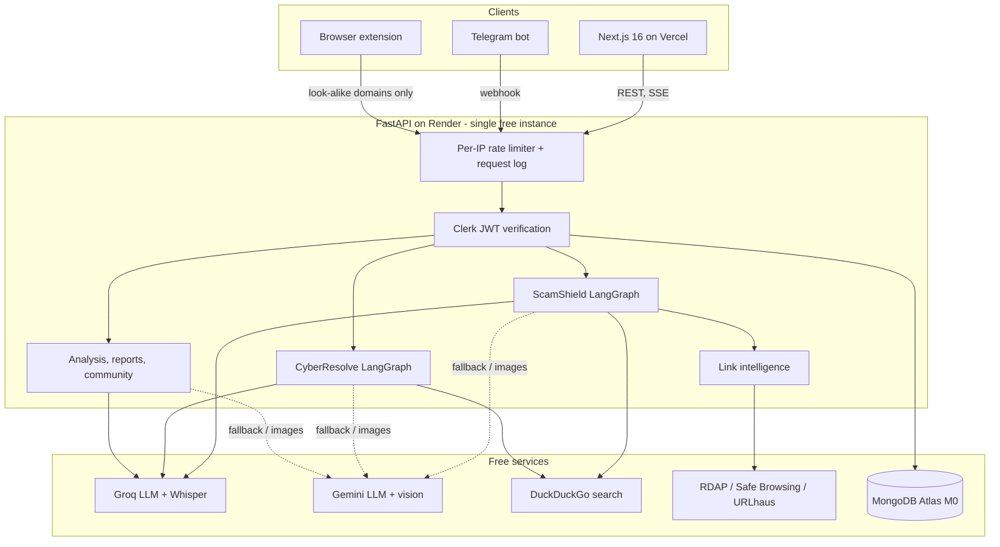

# 🛡️ CyberGuardAI

**An AI assistant that helps people in India detect scams and recover from cybercrime.**

CyberGuardAI analyses suspicious messages, screenshots and links, builds a step-by-step recovery plan for victims, prepares the evidence package the 1930 helpline and cybercrime.gov.in ask for, and remembers fraud indicators (UPI IDs, phone numbers, URLs) that several people have reported.

It runs entirely on free tiers: **Vercel**, **Render**, **MongoDB Atlas M0**, **Clerk**, **Groq** and **Gemini**.

---

## Features

| Feature | Where | Login | How it works |
|---|---|---|---|
| **ScamShield** | `/scamshield` | No | Message or screenshot → link checks → scam detection → web research → plain-language explanation and action plan. Live progress. English or Hindi. |
| **Link checks** | ScamShield, extension, `/api/url-check` | No | Domain age (RDAP), detection of bank/brand look-alikes against an official-domain list (including RBI's `.bank.in`), and optionally Google Safe Browsing and URLhaus. This is hard evidence: it sets a minimum risk score the AI can't go below. |
| **CyberResolve** | `/resolve` | No | Describe an incident → a phased recovery plan (containment → securing → reporting → recovery → prevention) and the relevant authorities. Follow-up questions, legal options and an FIR draft. Nothing is stored. English or Hindi. |
| **Cases** | `/dashboard`, `/cases/[id]` | Yes | Persistent cases: chat with the assistant, task checklist, screenshot analysis, PDF report and **evidence package**. |
| **Evidence package** | Case page | Yes | One PDF with the fields the cybercrime.gov.in financial-fraud form asks for, suspect identifiers extracted deterministically, a complaint narrative, and SHA-256 fingerprints of uploaded screenshots. |
| **Investigation console** | `/dashboard/cases/[id]` | Yes | Indicator extraction, threat-memory lookup, threat assessment, timeline and entity graph. |
| **Community reports** | Dashboard | Yes | Report a scam phone number, UPI ID or link. Every report is moderated (`/dashboard/moderation`, admins only). |
| **Telegram bot** | Telegram | No | Forward a suspicious message or screenshot and get a verdict back. |
| **Browser extension** | `extension/` | No | Warns on look-alike bank/brand sites. Privacy-first: ordinary browsing never leaves the browser. |
| **Demo cases** | Landing page | No | Three sample incidents, clearly labelled as sample data. Demos never write to the database. |

### Measured accuracy
`python -m app.evaluation.evaluate_detector` runs the detector over a labelled set. The current set has 70 hand-written messages: 40 scams covering 25 types common in India, and 30 legitimate messages, including real-style OTPs and bank alerts.

| Run (Oct 2026, `openai/gpt-oss-120b` on Groq) | Precision | Recall | False-positive rate |
|---|---|---|---|
| Only a "SCAM" verdict counts as flagged | 0.95 | 1.00 | 6.7% |
| "SCAM" or "SUSPICIOUS" counts as flagged | 0.91 | 1.00 | 13.3% |

No scams were missed. False alarms included a bank debit alert and an LPG booking confirmation. The set is small and synthetic, so add real, anonymised messages to `app/evaluation/data/scam_eval.jsonl` before relying on these numbers. Each run writes a full report, including every miss, to `app/evaluation/reports/`.

### Safety and honesty
- If the AI is unavailable, ScamShield returns a cautious **"unverified / suspicious"** result, never "safe".
- Web search results are treated as untrusted data: prompts mark them as such, and any non-official link in AI output is removed.
- An indicator becomes a **confirmed** threat only after **3 different signed-in users** report it. Community reports are moderated first.
- Scores such as "recovery probability" are LLM estimates. Audio analysis transcribes and assesses the call but does **not** detect deepfakes. Screenshot "tampering" is a visual judgement, not forensics.

### Privacy
- Users can download or delete all their data from the dashboard, and delete individual cases. Deleting data also withdraws their reports from threat memory.
- Anonymous ScamShield results expire after 90 days. Threat indicators nobody has reported for a year expire automatically (MongoDB TTL indexes).
- Screenshots are not stored; only extracted text and a SHA-256 fingerprint are kept. Deletions are recorded in an audit log using a hashed user id.
- See `/privacy` in the app.

---

## Architecture



**Workflows.**
- ScamShield: `profile → detect (with link evidence) → research → advise`.
- CyberResolve: `understand → (evidence ∥ research) → strategy → (guide ∥ authorities ∥ prevention)`.

Both workflows are compiled without a checkpointer, and both stream per-step progress over Server-Sent Events.

**AI providers.** Groq is the primary provider and Gemini is the fallback. Gemini is also used for images, and Groq Whisper for audio. Model names come from env vars (`GROQ_MODEL`, `GEMINI_MODEL`). Every AI call has a timeout, and fallbacks to the backup provider are logged.

---

## Free-tier deployment

### Backend on Render
1. Create a **Web Service** (or use `render.yaml` as a Blueprint) with root directory `backend` and health check path `/health`.
2. Set the backend variables from `.env.example` in the Render dashboard.

### Frontend on Vercel
Use root directory `frontend`. Set `NEXT_PUBLIC_API_URL`, `NEXT_PUBLIC_CLERK_PUBLISHABLE_KEY` and `CLERK_SECRET_KEY`, then add your Vercel URL to `ALLOWED_ORIGINS` and `CLERK_AUTHORIZED_PARTIES` on Render.

### Keeping Render awake (free)
Render's free instances sleep after 15 idle minutes, and waking takes about 30–60 s. One always-on service fits inside Render's 750 free hours per month. A **Vercel cron can't do this**: on the free Hobby plan, Vercel cron jobs run at most once per day. Use any of these instead (all free):

| Option | Interval | Notes |
|---|---|---|
| **UptimeRobot** (recommended) | 5 min | Monitor `https://<backend>/health`. Also emails you when the backend goes down. |
| **cron-job.org** | down to 1 min | Plain HTTP GET to `/health`. |
| **GitHub Actions** (`.github/workflows/keep-alive.yml`) | 10 min | Add repository variable `BACKEND_URL`. GitHub can delay scheduled runs and pauses them after 60 days of repository inactivity, so use it as a backup. |

The frontend also shows a "waking up" banner if the backend is asleep.

### Optional free integrations
| Variable | What it enables |
|---|---|
| `SENTRY_DSN` | Backend error tracking (Sentry free tier). Errors only; request bodies are never sent. |
| `GOOGLE_SAFE_BROWSING_KEY` | Google Safe Browsing link checks |
| `URLHAUS_AUTH_KEY` | URLhaus malicious-URL lookups (free key from auth.abuse.ch) |
| `TELEGRAM_BOT_TOKEN`, `TELEGRAM_WEBHOOK_SECRET` | The Telegram bot. Register it once with `python scripts/set_telegram_webhook.py https://<backend>` |
| `ADMIN_USER_IDS` | Clerk user ids allowed to moderate community reports |
| `SERPAPI_API_KEY` | Look-ups of bank nodal-officer contacts |

### Scheduled checks
- **Every push and PR:** backend tests, TypeScript check and ESLint (`ci.yml`).
- **Weekly:** checks that every official link shown to victims still works (`link-check.yml`).

---

## Local development

```bash
# Backend
cd backend
python -m venv venv && venv\Scripts\activate      # macOS/Linux: source venv/bin/activate
pip install -r requirements.txt -r requirements-dev.txt
cp ../.env.example .env                             # fill in the backend section
uvicorn app.main:app --reload                       # http://localhost:8000/docs
python -m pytest -q tests                           # offline, no API keys needed
python -m app.evaluation.evaluate_detector          # accuracy report (uses your LLM keys)

# Frontend
cd frontend
npm install
# .env.local: NEXT_PUBLIC_API_URL=http://localhost:8000 plus your Clerk keys
npm run dev                                         # http://localhost:3000
```

Or run both with Docker: `docker compose up --build`. To load the browser extension, see `extension/README.md`.

---

## Tech stack
- **Frontend:** Next.js 16, React 19, TypeScript, Tailwind CSS, Framer Motion, React Flow, Clerk
- **Backend:** FastAPI, LangGraph, LangChain (Groq + Gemini), Motor/MongoDB, fpdf2, ddgs, httpx
- **Hosting:** Vercel + Render + MongoDB Atlas (all free tiers)
