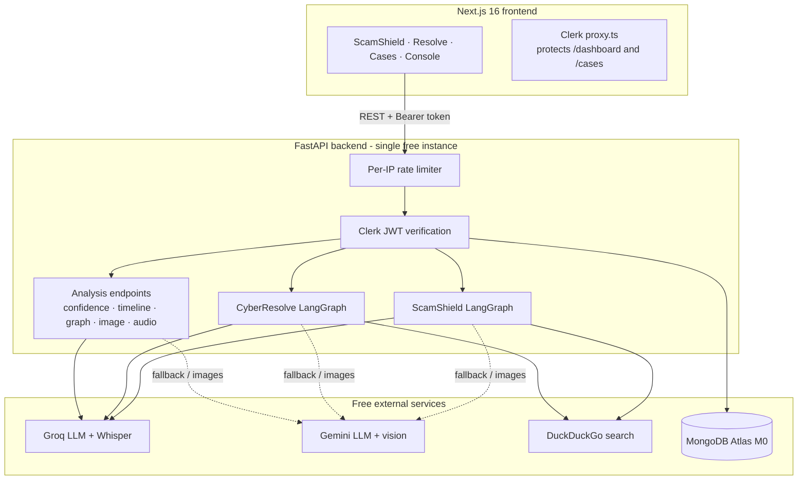

# 🛡️ CyberGuardAI

**An AI assistant that helps people in India detect scams and recover from cybercrime.**

CyberGuardAI analyses suspicious messages and screenshots, builds a step-by-step recovery plan for victims, points them to the right authorities (1930, cybercrime.gov.in, banks, platforms), and remembers fraud indicators (UPI IDs, phone numbers, URLs) that more than one person has reported.

It runs entirely on free tiers: **Vercel** (frontend), **Render** (backend), **MongoDB Atlas M0**, **Clerk**, **Groq** and **Gemini**.

---

## What it does

| Feature | Route | Login | How it works |
|---|---|---|---|
| **ScamShield** | `/scamshield` | No | Paste a message or upload a screenshot → profile → scam detection (with a small TF-IDF knowledge base of known patterns) → DuckDuckGo web/news/Reddit/X search → plain-language explanation + action plan. 3 LLM calls. |
| **CyberResolve** | `/resolve` | No | Describe an incident → a LangGraph workflow classifies it, researches it, builds a phased recovery plan (containment → securing → reporting → recovery → prevention) and maps authorities. Follow-up questions, legal-options and FIR-draft helpers. Nothing is stored. |
| **Cases** | `/dashboard`, `/cases/[id]` | Yes | Persistent cases in MongoDB: chat with the assistant, auto-generated task checklist, screenshot analysis, FIR/complaint text drafting, PDF report export. |
| **Investigation console** | `/dashboard/cases/[id]` | Yes | Extracts indicators (regex + screenshot OCR), checks them against threat memory, then produces a threat assessment, attack timeline and entity graph. |
| **Demo cases** | Landing page | No | Three sample incidents shown with clearly labelled sample data. Demos never write to the database. |

### Threat memory
Every indicator from a signed-in investigation is stored in `threat_entities`. An indicator is marked **confirmed** only after **3 different signed-in users** have reported it, so a single person can't brand an innocent number or UPI ID as malicious. The "Reported in multiple cases" feed shows real data from this collection. The scam advisories shown next to it are curated reference material and are labelled as such.

### Honest limits
- Scores such as "scam likelihood" and "recovery probability" are LLM estimates, not calibrated statistics.
- Audio analysis transcribes recordings with Groq Whisper and assesses the transcript. It does **not** detect voice deepfakes.
- Screenshot "tampering" is a visual judgement by the model, not forensic proof.
- The fraud-hub map shows districts reported in public news coverage. It is reference material, not live data.
- If the AI is unavailable, ScamShield returns a cautious **"unverified / suspicious"** result. It never returns "safe".

---

## Architecture



**CyberResolve graph:** `understanding → (evidence ∥ research) → strategy → (guide ∥ authorities ∥ prevention)`. It is compiled without a checkpointer: each run is one request, and the caller persists the result to MongoDB.

**LLM provider:** Groq is the primary provider and Gemini is the fallback (Gemini is also the only provider used for images). Model names come from env vars (`GROQ_MODEL`, `GEMINI_MODEL`), so a provider retiring a model is a config change, not a code change. Every agent uses one structured-output helper. When the LLM fails, agents fall back to honest defaults: the curated playbook for plans, and an "unverified" verdict for scams.

---

## Free-tier deployment

### Backend on Render
1. Create a **Web Service** from this repo (or use `render.yaml` as a Blueprint) with root directory `backend`.
2. Set the environment variables from `.env.example` (backend section) in the Render dashboard.
3. Health check path: `/health`.
4. **Avoid cold starts (optional):** Render's free instances sleep after 15 idle minutes, and waking takes about 30–60 s. The `keep-alive` GitHub Action pings `/health` every 10 minutes. Enable it by adding a repository **variable** `BACKEND_URL` (Settings → Secrets and variables → Actions → Variables). One always-on service fits inside Render's 750 free hours per month. The frontend also shows a "waking up" banner while it waits.

### Frontend on Vercel
1. Import the repo with root directory `frontend`.
2. Set `NEXT_PUBLIC_API_URL` (your Render URL), `NEXT_PUBLIC_CLERK_PUBLISHABLE_KEY` and `CLERK_SECRET_KEY`.
3. On Render, add your Vercel URL to `ALLOWED_ORIGINS` and `CLERK_AUTHORIZED_PARTIES`.

### Protecting the free quotas
- LLM endpoints are rate-limited per IP (full workflows: 10 per 10 minutes; single calls: 30 per 10 minutes).
- Request size is capped (text 8,000 characters, images 5 MB, audio 20 MB).
- Repeated web-research queries are cached for 6 hours.

---

## Local development

```bash
# Backend
cd backend
python -m venv venv && venv\Scripts\activate      # macOS/Linux: source venv/bin/activate
pip install -r requirements.txt -r requirements-dev.txt
cp ../.env.example .env                             # fill in the backend section
uvicorn app.main:app --reload                       # http://localhost:8000/docs
python -m pytest -q tests

# Frontend
cd frontend
npm install
# create .env.local with NEXT_PUBLIC_API_URL=http://localhost:8000 and your Clerk keys
npm run dev                                         # http://localhost:3000
```

Or run both with Docker: `docker compose up --build` (reads `./.env`).

CI (`.github/workflows/ci.yml`) runs the backend tests, the TypeScript check and ESLint on every push and PR.

---

## Tech stack
- **Frontend:** Next.js 16, React 19, TypeScript, Tailwind CSS, Framer Motion, React Flow, Clerk
- **Backend:** FastAPI, LangGraph, LangChain (Groq + Gemini), Motor/MongoDB, fpdf2, ddgs
- **Hosting:** Vercel + Render + MongoDB Atlas (all free tiers)
